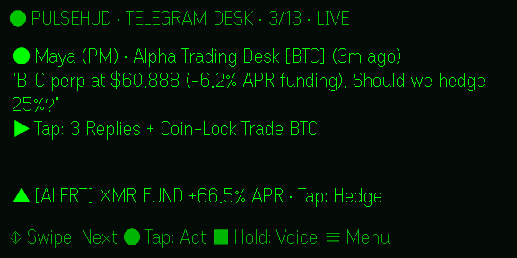
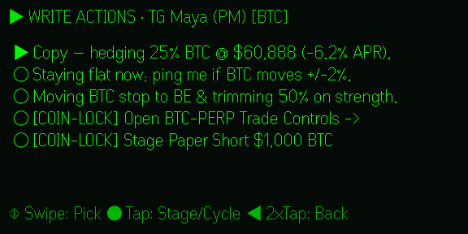
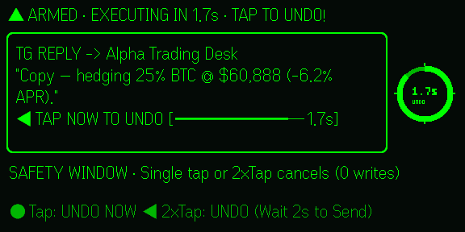
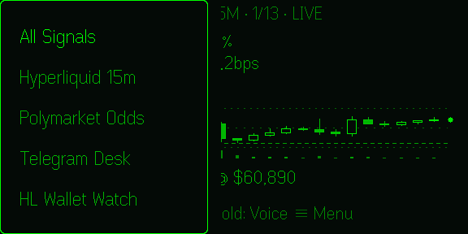
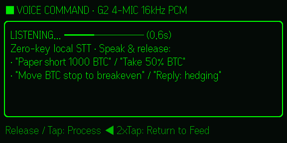
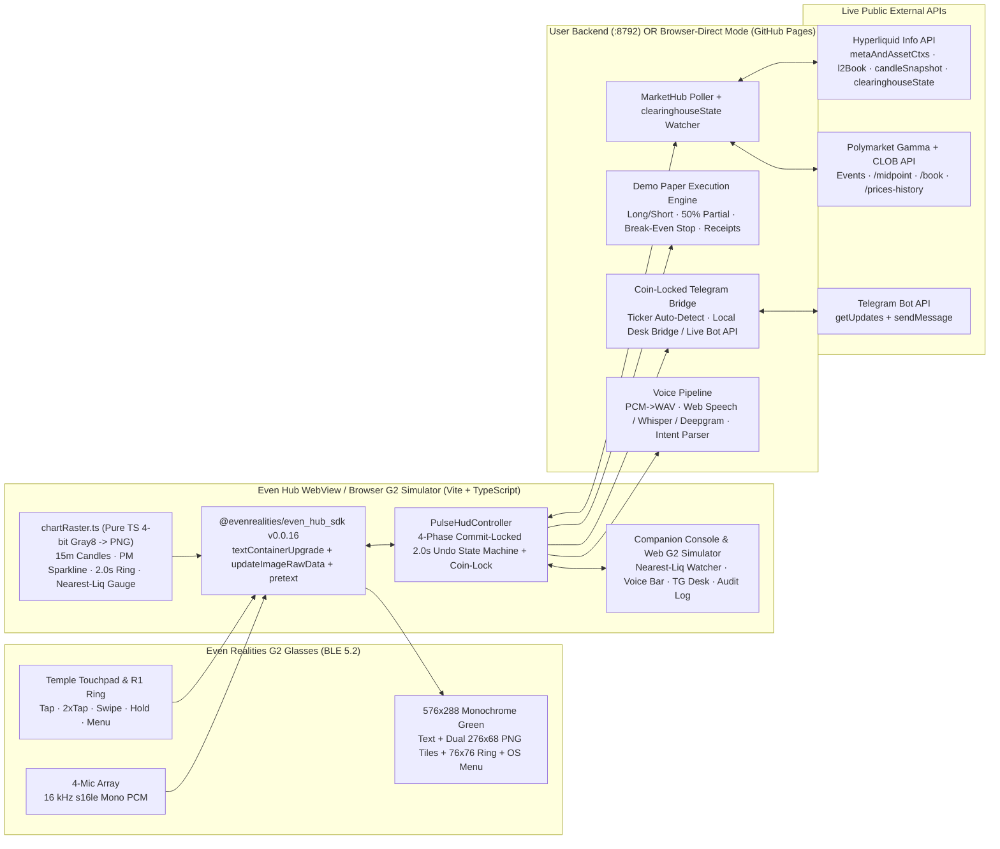

# PulseHUD v2.2 — Glanceable DeFi & Telegram HUD for Even Realities G2

[](https://alphonshhhomenicmtu.github.io/pulsehud-g2/)
[](https://www.youtube.com/watch?v=EHzgFv-Iw2o)

- **Watch the 1080p Official Simulator Demo (`v2.2`, 2m 33s):** **[https://www.youtube.com/watch?v=EHzgFv-Iw2o](https://www.youtube.com/watch?v=EHzgFv-Iw2o)**
- **Try PulseHUD in your browser (no install, no glasses required):** **[https://alphonshhhomenicmtu.github.io/pulsehud-g2/](https://alphonshhhomenicmtu.github.io/pulsehud-g2/)** — interactive 576×288 4-bit monochrome green Even G2 preview hitting live public Hyperliquid and Polymarket APIs directly, with clickable R1 ring / temple controls, keyboard shortcuts (`↑/↓` Scroll, `Enter` Tap, `Esc` Undo/Back, `M` OS Context Menu), proactive liq/funding/odds threshold alerts, nearest-liquidation `clearinghouseState` watcher, Coin-Locked Telegram-to-Trade, zero-key local STT fallback, and the commit-locked 2.0-second Arm/Undo Countdown Ring.

**PulseHUD** is a Read-and-Write companion app built for **Even Realities G2** smart glasses (`@evenrealities/even_hub_sdk@0.0.16`, `@evenrealities/pretext@0.1.4`, verified in `@evenrealities/evenhub-simulator@0.9.5`).

It brings **Hyperliquid perpetuals (15m OHLC candles, full 5-coin L2 quotes, and public `clearinghouseState` monitoring)**, **Polymarket CLOB odds (24h sparklines)**, and a **Coin-Locked Telegram trading desk** onto the camera-free 576×288 monochrome G2 display. Each screen holds one signal in a few lines, fits inside the 999-byte container budget and ~1 Hz BLE cadence, and puts every write behind a **2.0-second Arm/Undo Countdown Ring** before anything executes.

- **Primary Track:** `02 · Crypto & DeFi` (Hyperliquid + Polymarket)
- **Secondary Track:** `01 · Messaging & News` (Telegram)
- **Special Prize Target:** `Best Telegram Integration` & `Grand Prize`
- **Safety Posture:** Paper-trading and read-only execution only. No private keys, no custody, no financial advice, and the seeded $25,000 ledger is explicitly labeled `DEMO`. Every write requires four explicit steps: pick a signal -> open actions -> stage on the Confirm Gate -> tap to arm the 2.0s undo ring (tap again within 2.0s to cancel with zero writes, or let the timer finish to commit).
- **Telegram Mode Disclosure:** Out of the box (with no bot token set), PulseHUD runs a local **Telegram Desk Bridge** inbox so anyone can test the full alert -> smart reply -> coin-locked trade loop immediately. Setting `TELEGRAM_BOT_TOKEN` and `TELEGRAM_CHAT_ID` on your own backend switches delivery to live Telegram Bot API (`getUpdates` + `sendMessage`).

---

## What Changed in PulseHUD v2.2

1. **Zero-Key Local STT Fallback + 30-Case Voice-Eval Suite (`server/voice/localStt.ts`, `server/voice/intent.ts`, `tests/voice-eval.test.ts`):**
   - Adds a zero-dependency **16 kHz PCM Voice Activity Detection (VAD)** gate (`analyzePcmSpeech`) so silent or accidental temple long-presses never trigger phantom trades or waste STT calls.
   - Adds zero-key local STT fallback (`LOCAL_STT_URL` for local `whisper.cpp` / faster-whisper servers, auto-detected `whisper-cli` / `whisper` binaries, and zero-key Browser Web Speech API + Voice Bar) while keeping optional `OPENAI_API_KEY` / `DEEPGRAM_API_KEY` support on your own Node backend.
   - Hardens `parseVoiceIntent` with negation/abort guards (`"Don't short BTC"`, `"Cancel that order"`), comma & `k`-shorthand amount parsing (`$1,500`, `2.5k`), and strict market-context matching so ambient `"yes"`/`"no"`/`"long day"` speech never false-triggers — verified by a dedicated **30-case voice-eval suite** (`65 / 65` total Vitest tests passing, **0 false executions**).
2. **Proactive Liquidation / Funding / Odds Threshold Alert Banner (`src/hud/alerts.ts`, `src/hud/layout.ts`, `src/hud/controller.ts`, `src/companion/panel.ts`):**
   - Continuously monitors live feeds for three actionable breaches: watched wallet **`liqDistancePct < 5%`** (critical priority), Hyperliquid **`|fundingAprPct| >= 25% APR`**, and Polymarket **`|change24hCents| >= 5c`**.
   - Surfaces a crisp single-line `▲ [ALERT]` banner directly on the 576×288 G2 feed HUD (and in the Companion WebView) with 1-tap counter-hedge staging (still gated by the 2.0s Arm/Undo ring) and an **`Alert Hedge / Ack`** OS menu shortcut — staying within the `<= 999` byte and zero-scrollbar LVGL limits.
3. **Captured Voice HUD QA (`docs/screenshots/13-voice-hud.png`), Fresh `.ehpk v2.2.0` & 1080p V2.2 Simulator Demo Video:**
   - `npm run verify:sim` now captures `13-voice-hud.png` during `long_press` verification alongside `01..12` (**0 console errors**, **0 missing LVGL glyphs**).
   - Repackaged `pulsehud-g2.ehpk` (`v2.2.0`, `min_app_version: 2.2.10`, SDK `0.0.16`) and rendered a refreshed 1080p V2.2 simulator demo video showcasing all 13 live captures.

## Core Architecture (v2.1 + v2.2)

1. **Commit-Locked 4-Phase 2.0s Arm/Undo State Machine (`src/hud/controller.ts`):**
   - Uses an explicit `phase: 'idle' | 'armed' | 'committing' | 'done'` state machine with a monotonic `commitId` guard.
   - Tapping on the Confirm Gate arms the `76×76` 4-bit countdown ring (`2.0s -> 0.0s`) at a BLE-friendly 4 Hz cadence. A second tap or double-tap during the window cancels cleanly (`UNDONE`, zero writes).
   - At `0.0s`, the controller enters `'committing'` synchronously before awaiting execution, locking tap, double-tap, scroll, long-press, and menu events until the receipt settles so a boundary tap can never re-arm or double-send an in-flight order or Telegram message.
2. **Honest 15m Candle Status (`LIVE` / `SYNC` / `FALLBACK`) + Full 5-Coin L2 Coverage (`server/feeds/hyperliquid.ts`, `src/hud/layout.ts`, `src/hud/chartRaster.ts`):**
   - Real Hyperliquid `candleSnapshot` bars render under `LIVE`.
   - If a coin's `candleSnapshot` request fails or returns fewer than 6 bars, PulseHUD never fabricates candles under a `LIVE` pill—it displays `SYNCING 15M CANDLES` with a `SYNC` header.
   - Offline replay / synthetic fallback candles are explicitly labeled `FALLBACK` in the lens header and stamped `SYN` / `FALLBACK` on the chart tile.
   - All five rendered Hyperliquid markets (BTC, ETH, SOL, HYPE, plus the top funding-anomaly coin) fetch live `l2Book` quotes; missing quotes fall back to `L2 --` instead of `Live`.
3. **Nearest-Liquidation-First `clearinghouseState` Wallet Watcher (`server/feeds/hyperliquid.ts`, `src/hud/layout.ts`, `src/companion/panel.ts`):**
   - Paste any public `0x...` Hyperliquid address (or pick an active preset) to monitor read-only positions.
   - Positions are sorted by **smallest `liqDistancePct` ascending** (`null` last) so Row 1 on the 576×288 lens, the first cell of the liquidation cushion gauge, and the lead metric card in the companion panel always surface the position closest to liquidation—not just the largest BTC notional.
4. **Coin-Locked Telegram -> Trade + Demo Paper Risk Controls:**
   - Telegram alerts mentioning any Hyperliquid ticker (`BTC`, `ETH`, `SOL`, `HYPE`, etc.) surface `[COIN-LOCK] Open <COIN>-PERP Trade Controls` and `[COIN-LOCK] Stage Paper Short` alongside three concise desk reply drafts (written in natural desk phrasing, never naming the glasses).
   - Open demo paper positions support **Take 50% Partial Close**, **Move Stop -> Break-Even**, and on-glasses order size cycling (`$250 / $500 / $1,000 / $2,500`) with zero typing.
   - The seeded paper book is clearly prefixed `DEMO` on the lens (`DEMO PAPER BOOK`) and companion panel, and browser-direct mode seeds paper entries after the first live price refresh.
5. **Verified Voice HUD Glyphs & Defensive PCM Buffering (`src/hud/audio.ts`):**
   - Voice level meters use firmware-verified `━` / `─` glyphs (verified with 0 LVGL missing-glyph warnings inside `evenhub-simulator@0.9.5`, replacing unverified block elements).
   - `GlassesAudioCapture.pushPcm()` copies incoming `Uint8Array` frames (`frame.slice()`) so host buffer reuse cannot overwrite earlier audio chunks.

---

## Hardware Fit & Known Platform Notes

- **Camera-free by design:** PulseHUD uses zero camera or photo features. Every screen is built for Even G2's 576×288 monochrome 4-bit green display, single firmware font, 999-byte container limit, and ~1 Hz BLE update budget.
- **Keep the backend in your hands:** Telegram bot tokens and optional cloud STT keys live strictly on your own Node backend (`server/index.ts`), never inside the `.ehpk` bundle. If the local backend is unreachable (such as on GitHub Pages), `src/api/client.ts` switches to browser-direct public market fetches.
- **iOS backgrounding note:** On iPhone, the Even app currently suspends Even Hub WebView polling and microphone audio while backgrounded; PulseHUD keeps HUD state intact across `FOREGROUND_EXIT` / `FOREGROUND_ENTER` and resyncs live market state automatically when foregrounded again.

---

## Verified Simulator Screenshots (Even Hub Simulator `v0.9.5`)

Every HUD capture below was rendered by the LVGL engine inside `@evenrealities/evenhub-simulator@0.9.5` against live Hyperliquid (`metaAndAssetCtxs`, `l2Book`, `candleSnapshot`, `clearinghouseState`) and Polymarket (`gamma-api`, `clob`) APIs (**0 console errors**, **0 missing LVGL glyphs**, including the voice HUD). Raw transparent RGBA captures are stored in `docs/screenshots/raw/`, while `docs/screenshots/` composites them onto a dark lens (`#040A06`) for readability.

| 1. Borderless 15m Hyperliquid OHLC Candles (`updateImageRawData`) | 2. Live Polymarket CLOB 24h Sparkline (`updateImageRawData`) |
|---|---|
|  |  |
| **3. Coin-Locked Telegram Desk Alert** | **4. 3 Smart Replies + Coin-Lock Trade Jump** |
|  |  |
| **5. Confirm Gate with Standby 2.0s Ring** | **6. Live 2.0s Armed Undo Countdown Ring (`updateImageRawData`)** |
|  |  |
| **7. Confirmed Reply Delivery Toast** | **8. Dynamic Size + 50% Partial + Break-Even Controls** |
|  |  |
| **9. Native G2 OS Contextual Menu** | **10. Nearest-Liquidation `clearinghouseState` Wallet Watcher** |
|  |  |
| **11. Demo Paper Book Ledger** | **12. Companion WebView Console (macOS WKWebView)** |
|  |  |
| **13. Voice Command HUD (G2 4-Mic 16 kHz PCM + Zero-Key Local STT)** | **Verified Simulator QA Report** |
|  | `evenhub-simulator@0.9.5` · `0` console errors · `0` LVGL missing glyphs · `65/65` Vitest passing ([verification-report.json](docs/screenshots/verification-report.json)) |

---

## Architecture



---

## Controls & Read-and-Write Safety Flow

A complete write takes three taps plus the 2.0s safety window (feed -> actions -> arm -> countdown expiry):

| Gesture (G2 Temple / R1 Ring / Web Keys) | Feed Screen | Action Picker | Confirm Gate (`idle`) | Armed 2.0s Window (`armed`) | In-Flight (`committing`) | HL Wallet Watch / Demo Book |
|---|---|---|---|---|---|---|
| **Swipe Up / Down (`↑ / ↓`)** | Next / previous signal (in-place text + `updateImageRawData`) | Move `▶` option cursor | Toggle `▶ ARM 2.0s` / `○ Cancel` | Ignored | Locked | Return to Feed |
| **Single Tap (`Enter / Space`)** | Open Write Actions / Smart Replies / Coin-Lock Jump | Stage on Confirm Gate OR cycle size OR jump to coin | **Arm 2.0s Undo Ring** (0 writes yet) | **UNDO & CANCEL (`UNDONE`, 0 writes)** | **Locked** (cannot re-arm or double-send) | Stage counter-hedge for nearest-liq coin / flatten top position |
| **Double-Tap (`Esc`)** | Native G2 exit dialog via `shutDownPageContainer(1)` | Back to Feed | Cancel & return to Feed | **UNDO & CANCEL (`UNDONE`, 0 writes)** | **Locked** | Back to Feed |
| **Long Press** | Open G2 4-Mic Voice HUD (`audioControl(true)`) | Open Voice HUD | Open Voice HUD | Cancels armed countdown & opens Voice HUD | **Locked** | Open Voice HUD |
| **OS Menu (`M`)** | Switch channel, `HL Wallet Watch`, `Paper Portfolio`, or `Send Digest -> TG` | Same | Same | Cancels armed countdown & navigates | **Locked** | Same |

---

## Quickstart & Local Setup

### Prerequisites
- **Node.js** `>= 20` (tested on `v24.14.0`)
- **npm** `>= 10`
- No physical Even G2 glasses or paid API keys are required to run live market feeds, 15m charts, `clearinghouseState` wallet monitoring, and simulator verification.

### 1. Install dependencies

```bash
npm install
```

### 2. Optional configuration (`.env`)

```bash
cp .env.example .env
```

Optional environment variables in `.env` (never committed):
- `WATCHED_HL_ADDRESS` — default public `0x...` Hyperliquid address to watch via read-only `clearinghouseState`.
- `TELEGRAM_BOT_TOKEN` & `TELEGRAM_CHAT_ID` — switches Telegram from local Desk Bridge mode to live Bot API (`getUpdates`, `/status`, `/positions`, `/odds`, and outbound `sendMessage`).
- `OPENAI_API_KEY` or `DEEPGRAM_API_KEY` — optional cloud STT for raw G2 16 kHz PCM capture (Browser Web Speech API and the companion Voice Bar work with zero keys).
- `OFFLINE_REPLAY=true` — forces offline replay mode (labeled `FALLBACK` / `REPLAY`) for air-gapped demos.

### 3. Run locally & launch official Even Hub Simulator

```bash
# Terminal 1: Backend (:8792) + Companion WebView (:5178)
npm run dev

# Terminal 2: Official Even Hub Simulator v0.9.5
npm run simulate
```

### 4. Tests, Packaging (`.ehpk`), GitHub Pages Static Build & Automated Simulator QA

```bash
# TypeScript strict check + Vitest unit & regression suite
npm run typecheck
npm test

# Build & package v2.2.0 Even Hub .ehpk bundle
npm run pack

# Build static Browser 576x288 G2 Simulator for GitHub Pages
npm run build:pages

# Automated end-to-end verification in evenhub-simulator v0.9.5
npm run verify:sim
```

---

## Engineering Notes & Even G2 Compliance

- **Dual-Tile Graphics (`src/hud/chartRaster.ts`):** Even G2 caps `ImageContainerProperty` at `288×144` px per container. PulseHUD renders `552×68` 4-bit monochrome charts into a quantized Gray8 buffer (>70% transparent black pixels) and slices them into two adjacent `276×68` RFC-2083 PNG tiles via `bridge.updateImageRawData()`, plus a `76×76` 2.0-second Undo Countdown Ring on the Confirm Gate.
- **Zero-Scrollbar LVGL Fit (`src/hud/layout.ts`):** Every text box uses `@evenrealities/pretext` line wrapping and 27 px firmware line-height slack so LVGL never steals temple/ring swipes, using only verified Even G2 glyphs (**0 missing-glyph warnings**).
- **Protobuf Zero-Value Input Handling (`src/hud/events.ts`):** Resolves omitted zero-value `OsEventTypeList.CLICK_EVENT` strictly inside non-null `sysEvent` / `textEvent` / `listEvent` envelopes so incoming `audioEvent` PCM frames and `menuItemClickEvent` payloads never produce phantom clicks.
- **Commit-Locked 2.0s Undo State Machine (`src/hud/controller.ts`):** Transitions `idle -> armed -> committing -> done` with a `commitId` generation check so tapping at the 0.0s boundary can never re-arm or double-execute an in-flight write.
- **Even Hub QA Exit Compliance:** Root-page double-tap calls `bridge.shutDownPageContainer(1)` for the native Even OS exit confirmation overlay, and `FOREGROUND_ENTER` / `FOREGROUND_EXIT` preserve app state.

---

## Hackathon Disclosure & Companion Documents

- **Built during the hackathon (Nov 23–29, 2026):** 100% of PulseHUD's source code, backend feeds, 4-bit PNG chart rasterizer, HUD layouts, browser simulator, tests, and automation scripts were written from scratch during the hackathon week. External open-source libraries used: `@evenrealities/even_hub_sdk`, `@evenrealities/pretext`, `@evenrealities/evenhub-cli`, `@evenrealities/evenhub-simulator`, `vite`, `typescript`, `tsx`, `vitest`, `concurrently`.
- [Live Browser 576×288 G2 Simulator](https://alphonshhhomenicmtu.github.io/pulsehud-g2/) — Zero-install interactive web preview.
- [SPEC.md](SPEC.md) — Verified hackathon rubric, tracks, and G2 hardware specification.
- [docs/API-FEEDBACK.md](docs/API-FEEDBACK.md) — Optional hackathon deliverable: 5 concrete SDK & API feature requests.
- [docs/screenshots/verification-report.json](docs/screenshots/verification-report.json) — Machine-generated `evenhub-simulator v0.9.5` verification report.
