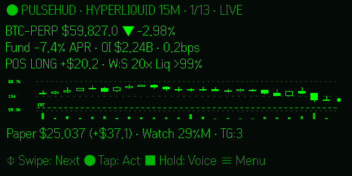
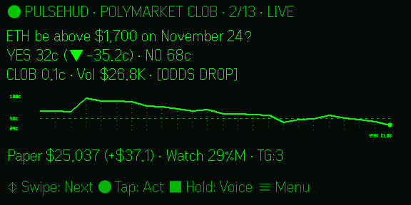
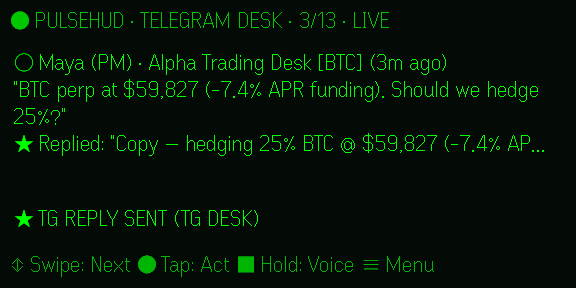
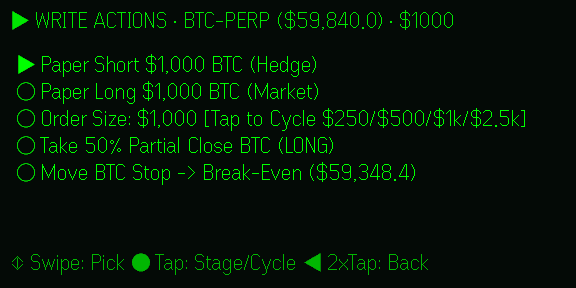
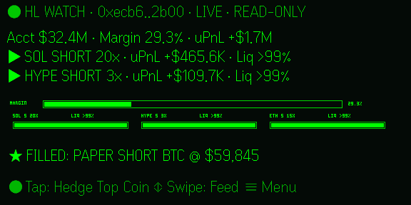
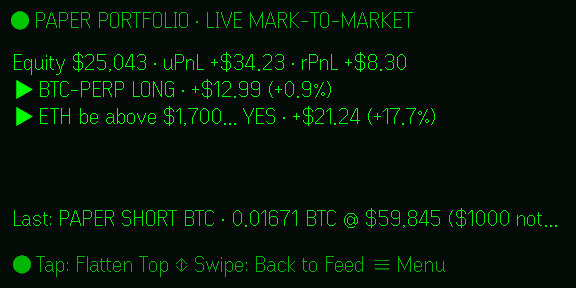
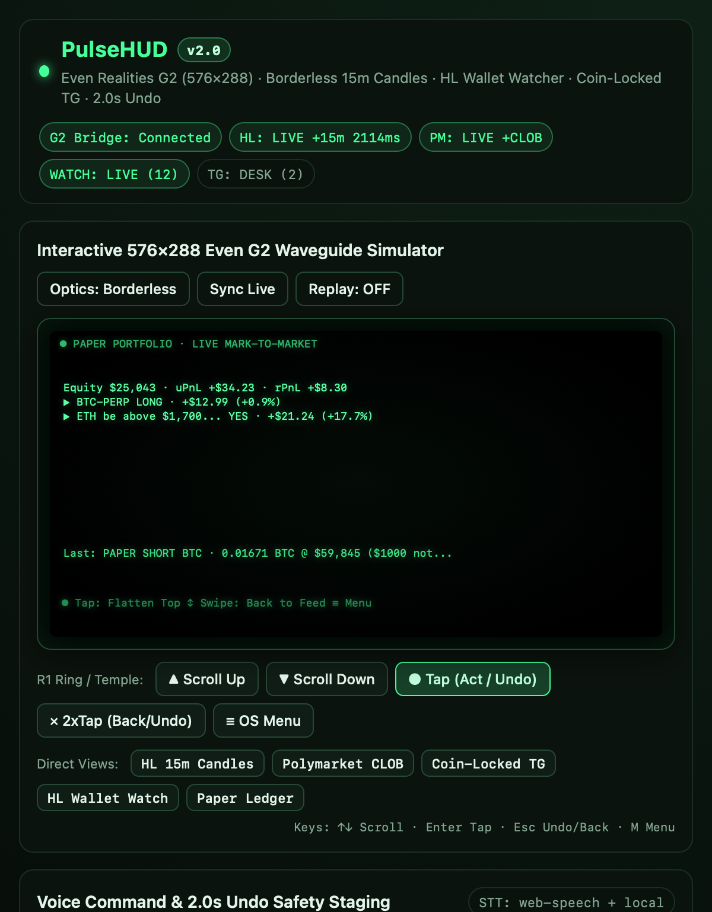

# PulseHUD v2.0 — Glanceable DeFi & Telegram Trading Copilot for Even G2

[](https://alphonshhhomenicmtu.github.io/pulsehud-g2/)

**Try PulseHUD instantly in your browser (zero install):** **[https://alphonshhhomenicmtu.github.io/pulsehud-g2/](https://alphonshhhomenicmtu.github.io/pulsehud-g2/)** — interactive 576×288 monochrome green Even G2 waveguide preview hitting live public Hyperliquid & Polymarket APIs directly, with clickable R1 ring / temple controls, keyboard shortcuts (`↑/↓` Scroll, `Enter` Tap, `Esc` Undo/Back, `M` OS Context Menu), live `clearinghouseState` wallet watcher, Coin-Locked TG->Trade, and the 2.0-second Undo Countdown Ring.

**PulseHUD** is a live-data, Read-and-Write companion application built natively for **Even Realities G2** smart glasses (`@evenrealities/even_hub_sdk@0.0.16`, `@evenrealities/pretext@0.1.4`, and verified inside the official `@evenrealities/evenhub-simulator@0.9.5`).

It unifies **Hyperliquid perpetual markets (live 15m OHLC candles + L2 book + public `clearinghouseState` watcher)**, **Polymarket CLOB prediction odds (24h probability sparklines)**, and a **two-way Coin-Locked Telegram trading desk** into a calm, borderless monochrome 576×288 heads-up display designed around a **3-second glance-and-act loop**—one focused signal on screen, transparent waveguide optics, and a **2.0-second post-tap Undo Safety Window** before every write action commits.

- **Primary Track:** `02 · Crypto & DeFi` (Hyperliquid + Polymarket)
- **Secondary Track:** `01 · Messaging & News` (Telegram)
- **Special Prize Target:** `Best Telegram Integration` & `Grand Prize`
- **Safety Posture:** Strict **paper-trading & read-only** execution. Zero private keys, zero custody, zero financial advice, and a mandatory **2.0-second Armed Undo Countdown Ring** where any single tap or double-tap cancels cleanly before execution.

---

## What's New in PulseHUD v2.0

1. **Borderless 15m Hyperliquid Candlestick & Polymarket Sparkline Graphics (`updateImageRawData`):**
   - Pure-TypeScript 4-bit monochrome rasterizer & standard RFC-2083 Gray8 PNG encoder (`src/hud/chartRaster.ts`) pushes real 15-minute Hyperliquid OHLC candles (hollow bullish bodies, shaded bearish bodies, volume intensity ticks, dashed `ENT`/`BE` & `LIQ` lines) and Polymarket 24h CLOB probability trajectories via two seamless SDK-compliant `276×68` `ImageContainerProperty` tiles (`552×68` full-width borderless waveguide optics, >70% transparent black pixels).
2. **Live Public-Address Hyperliquid `clearinghouseState` Watcher (Zero Custody, Read-Only):**
   - Paste any public `0x...` Hyperliquid address (or use 1-click live active leaderboard presets) to monitor live account value, **margin ratio %**, total unrealized PnL, and per-position **liquidation distance %** right on the G2 lens (`HL Wallet Watch` in the native OS Context Menu) with a live `updateImageRawData` margin & liquidation cushion gauge and 1-tap counter-hedge staging.
3. **Coin-Locked Telegram -> Trade Loop + Dynamic Risk Controls (`$250/$500/$1k/$2.5k`, 50% Partial Close, Break-Even Stop):**
   - Incoming Telegram alerts mentioning any Hyperliquid ticker (`BTC`, `ETH`, `SOL`, `HYPE`, etc.) automatically surface `[COIN-LOCK] Open <COIN>-PERP Trade Controls` and 1-tap coin-locked hedge actions right alongside 3 market-aware Smart Reply Drafts.
   - Open paper perp positions unlock 1-tap **Take 50% Partial Close**, **Move Stop -> Break-Even**, and on-glasses dynamic order size cycling (`$250 / $500 / $1,000 / $2,500`)—zero typing on smart glasses.
4. **2.0-Second Post-Tap Undo Safety Window (Visual Countdown Ring via `updateImageRawData`):**
   - Eliminates fat-finger risk on smart glasses: tapping `▶ ARM & EXECUTE` enters a visible **2.0-second armed countdown** with a glowing `76×76` 4-bit Countdown Ring graphic (`2.0s -> 0.0s`) and progress bar. Any single tap or double-tap during the 2.0s window cancels cleanly with zero writes.
5. **Interactive Zero-Install Browser 576×288 G2 Simulator on GitHub Pages:**
   - Deployed at **[https://alphonshhhomenicmtu.github.io/pulsehud-g2/](https://alphonshhhomenicmtu.github.io/pulsehud-g2/)** with dual-mode Browser-Direct live feeds (zero local install, HTTP 200, 0 console errors), plus Web Speech API zero-key mic capture and a 30-phrase voice intent evaluation suite (`0` false executions).

---

## Verified Simulator Screenshots (Even Hub Simulator `v0.9.5`)

Every HUD capture below was rendered by the real LVGL engine inside `@evenrealities/evenhub-simulator@0.9.5` against live Hyperliquid (`metaAndAssetCtxs`, `l2Book`, `candleSnapshot`, `clearinghouseState`) and Polymarket (`gamma-api`, `clob`) APIs (**0 console errors**, **0 missing LVGL glyphs**). Raw transparent waveguide RGBA PNGs are preserved in `docs/screenshots/raw/`, while `docs/screenshots/` composites them onto a dark obsidian lens (`#040A06`) for legibility on any background.

| 1. Borderless 15m Hyperliquid OHLC Candles (`updateImageRawData`) | 2. Live Polymarket CLOB 24h Sparkline (`updateImageRawData`) |
|---|---|
|  |  |
| **3. Coin-Locked Telegram Desk Alert** | **4. 3 Smart Replies + Coin-Lock Trade Jump** |
|  |  |
| **5. Confirm Gate with Standby 2.0s Ring** | **6. Live 2.0s Armed Undo Countdown Ring (`updateImageRawData`)** |
|  |  |
| **7. Confirmed Reply Delivery Toast** | **8. Dynamic Size + 50% Partial + Break-Even Controls** |
|  |  |
| **9. Native G2 OS Contextual Menu** | **10. Live Public `clearinghouseState` HL Wallet Watcher** |
|  |  |
| **11. Live Mark-to-Market Paper Ledger** | **12. Companion WebView Console (macOS WKWebView)** |
|  |  |

---

## Architecture


---

## Controls & Read-and-Write Safety Loop

| Gesture (G2 Temple / R1 Ring / Web Keys) | Feed Screen | Action Picker | Confirm Gate (Standby) | Armed 2.0s Undo Window | HL Wallet Watch / Portfolio |
|---|---|---|---|---|---|
| **Swipe Up / Down (`↑ / ↓`)** | Next / previous signal (flicker-free in-place text + `updateImageRawData` chart update) | Move `▶` option cursor | Toggle `▶ ARM` / `○ Cancel` | — | Return to Feed |
| **Single Tap (`Enter / Space`)** | Open Write Actions / Smart Replies / Coin-Lock Trade | Stage write OR cycle `$250/$500/$1k/$2.5k` OR jump to Coin-Locked coin | **Arm 2.0s Undo Countdown Ring** (zero execution yet!) | **UNDO & CANCEL CLEANLY (0 writes!)** | Stage counter-hedge / flatten top position |
| **Double-Tap (`Esc`)** | Native G2 exit dialog via `shutDownPageContainer(1)` | Back to Feed | Cancel & return to Feed | **UNDO & CANCEL CLEANLY (0 writes!)** | Back to Feed |
| **Long Press** | Open G2 4-Mic Voice Command HUD (`audioControl(true)`) | Open Voice Command HUD | — | — | Open Voice Command HUD |
| **OS Menu (`M`)** | Jump to `All Signals`, `Hyperliquid 15m`, `Polymarket Odds`, `Telegram Desk`, `HL Wallet Watch`, `Paper Portfolio`, or `Send Digest -> TG` | Same | Same | Cancels armed countdown & navigates | Same |

---

## Quickstart & Local Setup

### Prerequisites
- **Node.js** `>= 20` (tested on `v24.14.0`)
- **npm** `>= 10`
- No physical Even G2 glasses or paid API keys are required to run live market feeds, 15m charts, `clearinghouseState` wallet watch, and full simulator testing.

### 1. Install dependencies

```bash
npm install
```

### 2. Optional configuration (`.env`)

```bash
cp .env.example .env
```

Optional environment variables in `.env` (never committed):
- `WATCHED_HL_ADDRESS` — default public `0x...` Hyperliquid address to watch via read-only `clearinghouseState`.
- `TELEGRAM_BOT_TOKEN` & `TELEGRAM_CHAT_ID` — enables live two-way Telegram Bot polling (`getUpdates`, `/status`, `/positions`, `/odds`) and real outbound `sendMessage` delivery.
- `OPENAI_API_KEY` or `DEEPGRAM_API_KEY` — optional cloud STT for raw G2 16 kHz PCM capture (Browser Web Speech API + Companion Voice Bar work with zero keys).
- `OFFLINE_REPLAY=true` — forces verified offline replay mode for air-gapped stage demos.

### 3. Run locally & launch official Even Hub Simulator

```bash
# Terminal 1: Backend (:8792) + Companion WebView (:5178)
npm run dev

# Terminal 2: Official Even Hub Simulator v0.9.5
npm run simulate
```

### 4. Tests, Packaging (`.ehpk`), GitHub Pages Static Build & Automated Simulator QA

```bash
# TypeScript strict check + Vitest unit & eval suite (26 tests incl. 30-phrase voice eval & 2.0s undo)
npm run typecheck
npm test

# Build & package updated v2.0.0 Even Hub .ehpk bundle
npm run pack

# Build zero-install static Browser 576x288 G2 Simulator for GitHub Pages
npm run build:pages

# Automated end-to-end verification in real evenhub-simulator v0.9.5
npm run verify:sim
```

---

## Engineering Highlights & G2 Best Practices

- **Hardware-Compliant Dual-Tile Graphics (`src/hud/chartRaster.ts`):** Even G2 firmware caps `ImageContainerProperty` at `288×144` px per container. PulseHUD renders full-width `552×68` 4-bit monochrome charts into a quantized Gray8 pixel buffer (>70% transparent black pixels) and slices them cleanly into two adjacent `276×68` RFC-2083 PNG tiles pushed via `bridge.updateImageRawData()`, plus a dedicated `76×76` 2.0-second Undo Countdown Ring on the Confirm Gate.
- **Zero-Scrollbar LVGL Fit (`src/hud/layout.ts`):** Every text container enforces strict `@evenrealities/pretext` wrapping and exact 27 px firmware line-height budgets so zero internal LVGL scrollbars steal ring/temple swipes, and uses exclusively verified Even G2 firmware glyphs (**0 LVGL missing-glyph warnings**).
- **Protobuf Zero-Value Input Safety (`src/hud/events.ts`):** Resolves omitted zero-value `OsEventTypeList.CLICK_EVENT` strictly inside non-null `sysEvent` / `textEvent` / `listEvent` envelopes so incoming `audioEvent` PCM frames and `menuItemClickEvent` payloads never trigger phantom clicks.
- **2.0-Second Post-Tap Undo Safety State Machine (`src/hud/controller.ts`):** Decouples tap intent from destructive execution with a live ticking countdown ring and immediate single-tap/double-tap cancellation before any write reaches the paper ledger or Telegram Bot API.
- **Even Hub QA Exit Compliance:** Root-page double-tap invokes `bridge.shutDownPageContainer(1)` for the native Even OS exit confirmation overlay, and `FOREGROUND_ENTER` / `FOREGROUND_EXIT` menu events preserve full app state.

---

## Hackathon Disclosure & Companion Documents

- **Built during the hackathon (Nov 23–29, 2026):** 100% of PulseHUD's source code, backend feeds, 4-bit PNG chart rasterizer, HUD layouts, browser simulator, tests, and automation scripts were written from scratch during the hackathon week. External open-source libraries used: `@evenrealities/even_hub_sdk`, `@evenrealities/pretext`, `@evenrealities/evenhub-cli`, `@evenrealities/evenhub-simulator`, `vite`, `typescript`, `tsx`, `vitest`, `concurrently`.
- [Live Browser 576×288 G2 Simulator](https://alphonshhhomenicmtu.github.io/pulsehud-g2/) — Zero-install interactive web preview.
- [SPEC.md](SPEC.md) — Verified hackathon rubric, tracks, and G2 hardware specification.
- [docs/API-FEEDBACK.md](docs/API-FEEDBACK.md) — Optional hackathon deliverable: 5 concrete SDK & API feature requests.
- [docs/screenshots/verification-report.json](docs/screenshots/verification-report.json) — Machine-generated `evenhub-simulator v0.9.5` verification report.
