# PulseHUD — Glanceable DeFi & Telegram Trading Copilot for Even G2

**PulseHUD** is a live-data, Read-and-Write companion application built natively for **Even Realities G2** smart glasses (`@evenrealities/even_hub_sdk@0.0.16`, `@evenrealities/pretext@0.1.4`, and verified inside the official `@evenrealities/evenhub-simulator@0.9.5`).

It unifies **Hyperliquid perpetual markets**, **Polymarket CLOB prediction odds**, and a **two-way Telegram trading desk** into a calm, monochrome 576 × 288 heads-up display designed around a **3-second glance-and-act loop**—one focused signal on screen, zero dashboard clutter, and explicit human confirmation before every write action.

- **Primary Track:** `02 · Crypto & DeFi` (Hyperliquid + Polymarket)
- **Secondary Track:** `01 · Messaging & News` (Telegram)
- **Special Prize Target:** `Best Telegram Integration` & `Grand Prize`
- **Safety Posture:** Strict **paper-trading & read-only** execution. Zero private keys, zero custody, zero financial advice, and a mandatory high-contrast 1-tap confirmation gate before every trade or Telegram send.

---

## Why PulseHUD on Even G2?

Active crypto and prediction-market traders miss fast inflections—a Hyperliquid funding rate spike, a Polymarket odds breakout, or an urgent hedging call in their Telegram desk—whenever they walk away from their screen or sit in a meeting. Pulling out a phone breaks presence and turns a 3-second check into a 10-minute distraction.

PulseHUD uses the G2 lenses the way smart eyewear should be used:
1. **Read at a glance:** One live signal per screen, pixel-fitted with `@evenrealities/pretext` so zero words clip or overflow across the 576 × 288 micro-LED canvas.
2. **Write in seconds:** Single tap opens smart contextual defaults (paper hedge, paper YES/NO stake, or 3 market-aware Telegram reply drafts). Hold temple/R1 ring to capture 16 kHz PCM voice commands.
3. **Confirm safely:** Every write lands on a bright double-bordered **Confirm Gate** (`▶ CONFIRM & EXECUTE [TAP]` / `◀ 2xTap: Cancel`).

---

## Verified Simulator Screenshots (Even Hub Simulator `v0.9.5`)

Every HUD capture below was rendered by the real LVGL engine inside `@evenrealities/evenhub-simulator@0.9.5` against live Hyperliquid and Polymarket APIs (zero console errors, zero missing LVGL glyphs). Raw transparent waveguide RGBA PNGs are preserved in `docs/screenshots/raw/`, while `docs/screenshots/` composites them onto a dark obsidian lens (`#040A06`) for legibility on any background.

| 1. Live Hyperliquid Perp Card | 2. Live Polymarket + CLOB Odds |
|---|---|
| 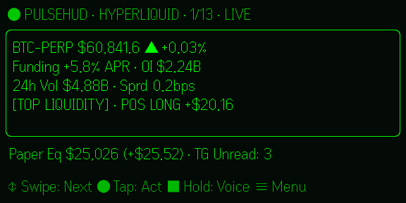 | 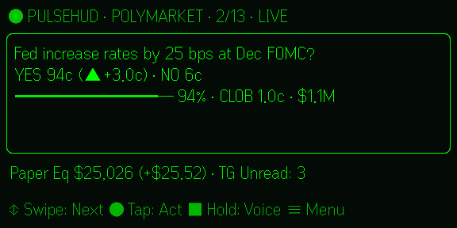 |
| **3. Telegram Desk Unread Alert** | **4. 1-Tap Context-Aware Smart Replies** |
| 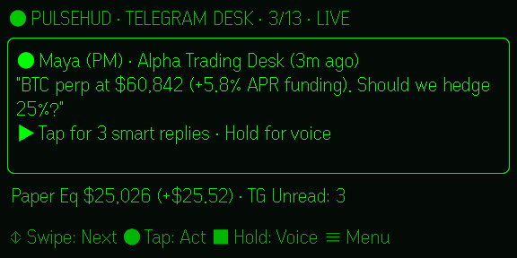 | 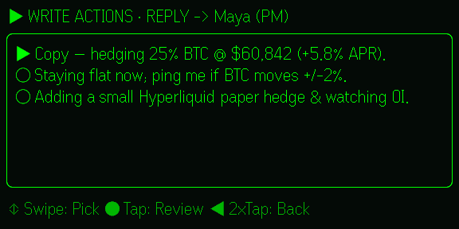 |
| **5. High-Contrast Write Confirm Gate** | **6. Confirmed Reply Delivery Toast** |
| 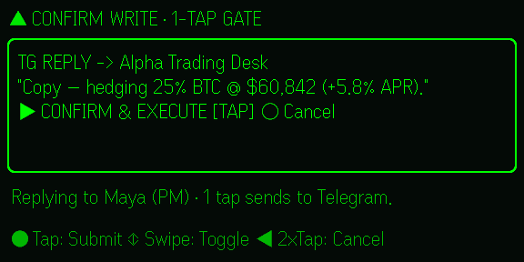 | 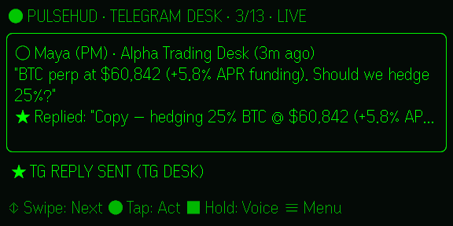 |
| **7. Hyperliquid Paper Write Actions** | **8. Paper Short Hedge Confirm Gate** |
| 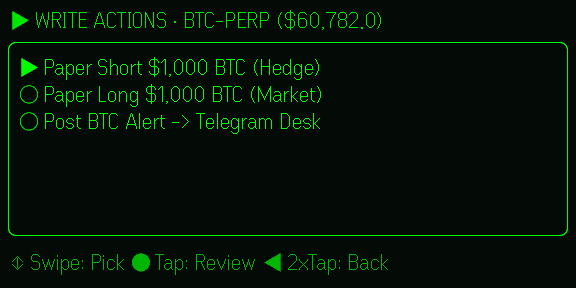 | 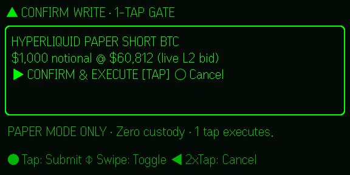 |
| **9. Native G2 OS Contextual Menu** | **10. Live Mark-to-Market Paper Ledger** |
|  | 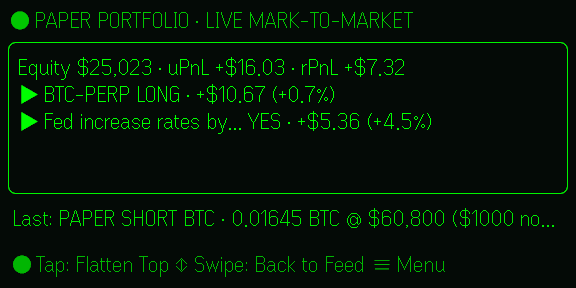 |

### Companion WebView Control Panel (macOS WKWebView Capture)

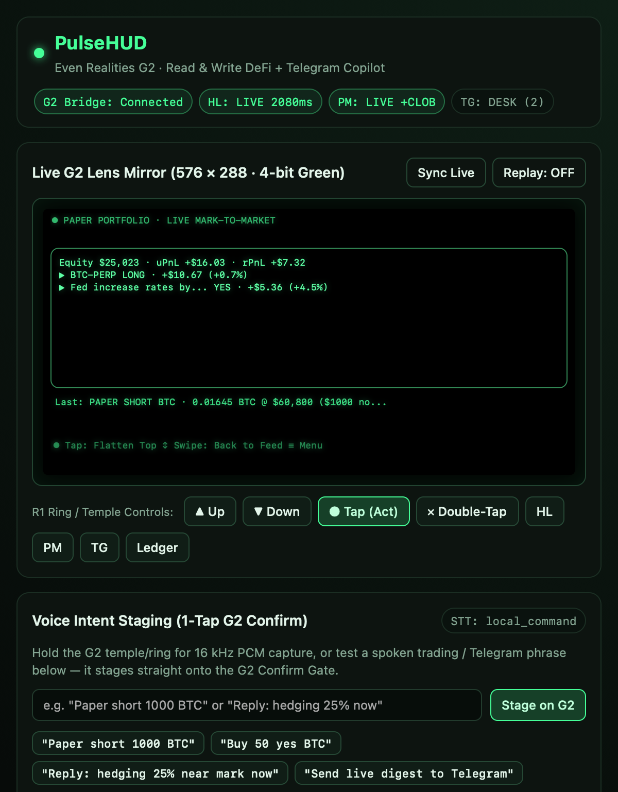

---

## Architecture

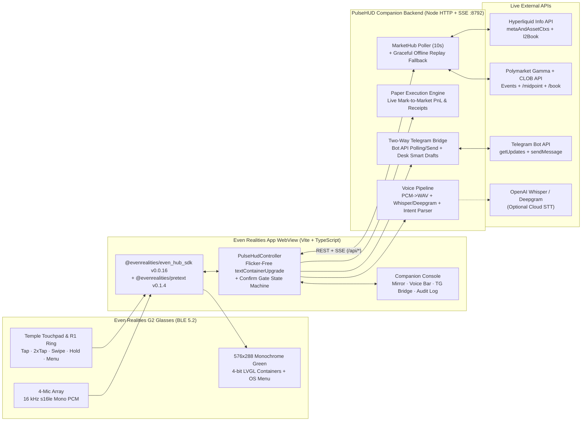

---

## Controls & Read-and-Write Flow

| Gesture (G2 Temple / R1 Ring) | Feed Screen | Action Picker | Confirm Gate | Paper Portfolio |
|---|---|---|---|---|
| **Swipe Up / Down** | Next / previous live signal (flicker-free `textContainerUpgrade`) | Move `▶` option cursor | Toggle `▶ CONFIRM` / `○ Cancel` | Return to Feed |
| **Single Tap (`CLICK`)** | Open Write Actions / Smart Replies for active card | Stage selected action on Confirm Gate | **Execute confirmed write** (Paper fill or Telegram send) | Stage flatten top paper position |
| **Double-Tap (`DOUBLE_CLICK`)** | Native G2 exit dialog via `shutDownPageContainer(1)` | Back to Feed | Cancel staged action & return to Feed | Back to Feed |
| **Long Press (`LONG_PRESS`)** | Open G2 4-Mic Voice Command HUD (`audioControl(true)`) | Open Voice Command HUD | — | Open Voice Command HUD |
| **Contextual Menu (`menuObject`)** | Jump to `All Signals`, `Hyperliquid Perps`, `Polymarket Odds`, `Telegram Desk`, `Paper Portfolio`, or `Send Digest -> TG` | Same | Same | Same |

---

## Quickstart & Local Setup

### Prerequisites
- **Node.js** `>= 20` (tested on `v24.14.0`)
- **npm** `>= 10`
- No physical Even G2 glasses or paid API keys are required to run live market feeds and full simulator testing.

### 1. Install dependencies

```bash
npm install
```

### 2. Optional configuration (`.env`)

PulseHUD works out of the box with live public **Hyperliquid** + **Polymarket** APIs and the interactive **Telegram Desk Bridge**. To connect a real Telegram Bot or cloud Speech-to-Text:

```bash
cp .env.example .env
```

Optional environment variables in `.env` (never committed):
- `TELEGRAM_BOT_TOKEN` & `TELEGRAM_CHAT_ID` — enables live two-way Telegram Bot polling (`getUpdates`, slash commands `/status`, `/positions`, `/odds`) and real outbound `sendMessage` delivery for confirmed G2 replies and market alerts.
- `OPENAI_API_KEY` or `DEEPGRAM_API_KEY` — transcribes live 16 kHz s16le PCM captured from the G2 4-mic array via OpenAI Whisper or Deepgram Nova-2.
- `OFFLINE_REPLAY=true` — forces verified offline replay mode for air-gapped stage demos (also toggleable live from the Companion WebView).

### 3. Start backend + companion dev server

```bash
npm run dev
```

- Backend API & SSE server: `http://127.0.0.1:8792`
- Companion WebView dev server: `http://127.0.0.1:5178`

### 4. Launch in the official Even Hub Simulator

In a second terminal:

```bash
npm run simulate
```

This runs `evenhub-simulator http://127.0.0.1:5178 --automation-port 9898`, opening both the live 576 × 288 monochrome G2 display and the companion WebView side by side.

### 5. Run tests, automated simulator QA, and `.ehpk` packaging

```bash
# TypeScript strict check + Vitest unit suite (18 tests)
npm run typecheck
npm test

# Build & package an Even Hub .ehpk bundle
npm run pack

# Automated end-to-end verification in real evenhub-simulator v0.9.5
npm run verify:sim
```

---

## Engineering Highlights & G2 Best Practices

- **Protobuf Zero-Value Input Safety (`src/hud/events.ts`):** Resolves `OsEventTypeList.CLICK_EVENT` (`0`, omitted on the protobuf wire) strictly *inside* non-null `sysEvent` / `textEvent` / `listEvent` checks so incoming `audioEvent` PCM frames and `menuItemClickEvent` payloads never trigger phantom clicks.
- **Pixel-Accurate LVGL Typography (`src/hud/layout.ts`):** Uses `@evenrealities/pretext` (`measureTextWrap` and `pxTruncate`) against exact inner container pixel widths and uses only verified Even G2 firmware glyphs (`●`, `○`, `▲`, `▼`, `▶`, `◀`, `■`, `★`, `━`, `─`, `↕`, `≡`)—verified at **0 LVGL missing-glyph warnings**.
- **Flicker-Free Live Updates (`src/hud/controller.ts`):** Keeps a stable 4-container layout on the signal feed so 10-second live market ticks and card swipes use `textContainerUpgrade` in place, reserving `rebuildPageContainer` (with `menuObject` preserved) only for screen transitions.
- **Even Hub QA Exit Compliance:** Root-page double-tap calls `bridge.shutDownPageContainer(1)` to invoke the native Even OS exit confirmation overlay, and `FOREGROUND_ENTER` / `FOREGROUND_EXIT` events from the contextual menu never drop app state.
- **Backend CORS & Secret Isolation (`app.json` + `server/index.ts`):** All external calls route through our Node backend; no API keys ship in the client bundle, and `app.json` declares explicit origin whitelists.

---

## 2-Minute Demo Video Script (Ready for DoraHacks Submission)

> **Recording setup:** Place the Even Hub Simulator glasses lens window on the left and the Companion WebView on the right (`npm run dev` + `npm run simulate`).

- **0:00 – 0:20 | The Problem & Instant Glance (Read)**
  - *"Active crypto and prediction-market traders constantly check Hyperliquid funding, Polymarket odds, and Telegram alpha groups—pulling out their phone mid-meeting. PulseHUD brings that entire desk onto Even Realities G2 glasses with one calm signal per screen."*
  - Show `01-feed-hyperliquid.png` live on the simulator: point out live BTC-PERP mark price, 24h change, annualized funding APR, L2 bid-ask spread, and live mark-to-market paper PnL.
- **0:20 – 0:45 | Live Polymarket CLOB + Telegram Desk (Read)**
  - Swipe down once (`down`): show the live **Polymarket** card (`02-feed-polymarket.png`) with CLOB-verified YES/NO cents, 24h swing, and visual progress bar.
  - Swipe down again (`down`): show an incoming **Telegram Desk** message (`03-feed-telegram.png`) from Maya asking whether to hedge 25% BTC at the live price.
- **0:45 – 1:15 | Telegram Read-and-Write in Two Taps (Best Telegram Integration)**
  - Tap once (`click`): show the 3 **context-aware Smart Reply Drafts** (`04-actions-telegram-drafts.png`) dynamically hydrated with the live BTC price and funding rate—zero typing on glasses.
  - Tap once (`click`): highlight the bright double-bordered **Safety Confirm Gate** (`05-confirm-telegram-reply.png`).
  - Tap once (`click`): execute! Show the instant confirmation toast (`06-executed-toast-feed.png`) on the lenses AND the delivered reply + unread counter updating live in the Companion Telegram Desk (and real Telegram Bot chat when configured).
- **1:15 – 1:40 | 1-Tap Paper Hedge & Voice Staging (Crypto & DeFi)**
  - Swipe back to BTC-PERP, tap -> pick `Paper Short $1,000 BTC (Hedge)` (`07-actions-hyperliquid-trade.png`) -> confirm on the `PAPER MODE ONLY` safety gate (`08-confirm-hyperliquid-paper-trade.png`) -> execute and show updated live net position.
  - Show voice intent staging (hold temple for 16 kHz PCM capture, or click `"Buy 50 yes BTC"` in the Companion voice bar) landing directly on the 1-tap Confirm Gate.
- **1:40 – 2:00 | Native G2 Contextual Menu, Paper Ledger & Safety Close**
  - Open the native **G2 Contextual Menu** (`09-context-menu-overlay.png`) -> select `Paper Portfolio` (`10-portfolio-ledger.png`) to display live equity, unrealized PnL, and execution audit receipts.
  - *"100% live Hyperliquid and Polymarket data, real two-way Telegram integration, paper-only zero-custody safety, and packaged as an Even Hub `.ehpk` ready for G2. That's PulseHUD."*

---

## Hackathon Disclosure & Companion Documents

- **Built during the hackathon (Nov 23–29, 2026):** 100% of PulseHUD's source code, backend feeds, HUD layouts, tests, and automation scripts were written from scratch during the hackathon week. External open-source libraries used: `@evenrealities/even_hub_sdk`, `@evenrealities/pretext`, `@evenrealities/evenhub-cli`, `@evenrealities/evenhub-simulator`, `vite`, `typescript`, `tsx`, `vitest`, `concurrently`.
- [SPEC.md](SPEC.md) — Verified hackathon rubric, tracks, and G2 hardware specification.
- [docs/API-FEEDBACK.md](docs/API-FEEDBACK.md) — Optional hackathon submission deliverable: 5 concrete SDK & API feature requests.
- [docs/screenshots/verification-report.json](docs/screenshots/verification-report.json) — Machine-generated simulator verification report.
